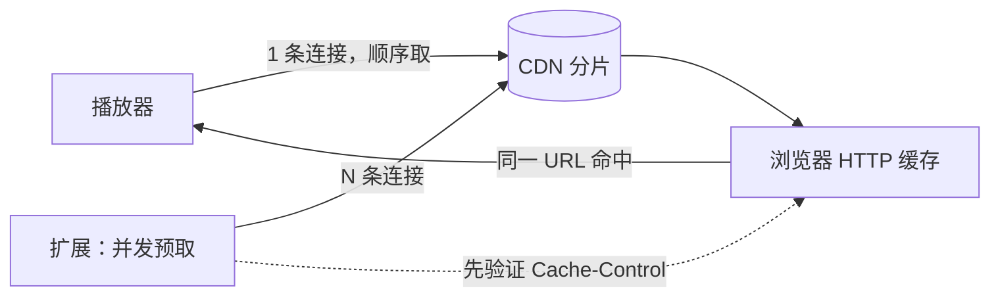

# 老司机方向盘 · StreamWheel

> 一个免费、开源、无遥测的 Chrome / Edge 扩展：替播放器**并发预取视频分片**，
> 减少拖动进度条和播放时的缓冲等待。
> **Take the wheel of your video stream.**

**English:** StreamWheel (老司机方向盘) is an open-source Chrome/Edge MV3 extension
that prefetches HLS/DASH segments in parallel into the browser cache, so playback hits
the cache instead of waiting on a single throttled connection. Free, no telemetry,
MIT licensed. The name plays on *take the wheel* — you stay in control of your stream.

---

## 先说清楚：它能做什么，不能做什么

这是本项目最重要的一节。**浏览器扩展加不了带宽，也突破不了服务端或账号的配额**——
任何声称能「一键破解网速」的工具都不诚实。它改变的是**取数据的方式**：播放器通常
一条连接顺序取分片，扩展用多条连接把后续分片提前拉进浏览器缓存，播放器再请求同一批
URL 时直接命中缓存。

| 情况 | 能不能改善 | 说明 |
|---|---|---|
| 单连接被限速（CDN 对每条 TCP 封顶） | ✅ 能 | 多连接叠加，本项目的主要场景 |
| 拖动进度条到未缓存位置要缓冲 | ✅ 能 | 「立刻享受」或「存着慢慢看」二选一 |
| CDN 允许缓存（`max-age` / `Expires`） | ✅ 能 | 预取结果才会被播放器命中 |
| 平台会员限速 / 账号总量封顶 | ❌ 不能 | 商业规则，本项目不提供绕过手法 |
| 运营商或家宽带宽本身不足 | ❌ 不能 | 换出口、DNS、IPv6 才是对的路线 |
| CDN 返回 `Cache-Control: no-store` | ❌ 不能 | 预取不进缓存，纯属白耗流量，扩展会检测并如实告知 |
| 播放器每次给分片换签名 | ❌ 不能 | 预取 URL 与播放器请求的不是同一个，命中不到 |
| DRM / 单文件 mp4 / 纯直播流 | ❌ 不能 | 无可解析的分片列表 |

**关键词**：老司机方向盘、StreamWheel、视频缓冲、拖动秒开、HLS、DASH、m3u8、mpd、
分片预取、单连接限速、CDN 缓存、Chrome 扩展、video buffering、prefetch、playback stall。

---

## 快速开始

1. 下载或 clone 本仓库。
2. 打开 `chrome://extensions`，右上角开启「开发者模式」。
3. 点「**加载已解压的扩展程序**」，选择仓库里的 `extension/` 目录。
4. 打开一个视频页面，刷新一次，左下角出现角标即生效。

> 仓库版不含二进制图标，`manifest.json` 里也没有引用图标，Chrome 会用默认图标，
> 功能完全不受影响。想要自定义图标，运行 `python3 skill/scripts/make_icons.py`
> （需 `pip install pillow`），生成 4 个 PNG 后自行在 manifest 里补回 `icons` 字段。

> 扩展会申请「读取和更改所有网站上的数据」——这是预取任意站点分片所必需的。
> 代码全部在本仓库，可以自己审查；它不上传任何数据、不请求任何第三方服务器。

---

## 两个开关（互斥）

| 开关 | 行为 | 流量代价 |
|---|---|---|
| **存着慢慢看** | 后台把整片所有分片缓存下来，之后随便拖都不卡 | 完整下载一次视频，默认上限 150 MB |
| **立刻享受** | 点/拖进度条到哪，就把那附近的分片提到队首先缓冲 | 只改下载顺序，几乎不增加总量 |

打开其中一个，另一个会自动关闭；关掉当前这个，两个都保持关闭。
「存着慢慢看」开启前会**先自动验证缓存是否命中**，未命中则跳过整片下载，
避免白耗几百 MB 流量。仅对点播有效，直播没有完整分片表。

角标示例：

```
预取 10 段 · 5.4 MB · 可缓存        ← 常规预取，缓存策略正常
全片 20/20 段 · 1.3 MB · 可缓存    ← 整片已缓存完
已在播 · 列表请求被拒              ← 跨域/鉴权失败，弹窗里有完整诊断
```

---

## 原理



### 为什么先诊断再动手

「视频慢」是四类完全不同的问题，用错工具只会白折腾：

| 层 | 限速主体 | 客户端能否加速 |
|---|---|---|
| L1 单连接 | 服务端对每条 TCP 封顶 | **能**，多连接叠加 |
| L2 账号/会话 | 平台按账号限总带宽 | 不能（属会员权益，不绕过） |
| L3 运营商链路 | QoS、跨网、晚高峰 | 部分能（DNS / IPv6 / 中转） |
| L4 本地链路 | WiFi、路由器 QoS、MTU | 能，纯本地优化 |

项目里附带 `skill/scripts/speed_probe.py`，用 **1 连接 vs N 连接的吞吐比**
把限速层级钉死：

- 加速比 **≥ 2.2×** → L1，多线程有效，值得用这个扩展
- **1.4 ~ 2.2×** → 部分叠加，并发别开太高
- **< 1.4×** → L2/L3，多线程工具完全无效，别再折腾

```bash
python3 skill/scripts/speed_probe.py "<媒体直链>" --levels 1,4,8,16 --seconds 6
```

### 实现要点

- **播放列表解析**：同时支持 m3u8（含 master variant）与 MPD/DASH
  （SegmentTemplate、SegmentTimeline、SegmentList、`$Number$` 等模板替换）。
- **三级取列表兜底**：`credentials: omit` → `include` → background service worker 代取。
  这一条专门治 `Failed to fetch`：跨域 CDN 返回 `Access-Control-Allow-Origin: *` 时，
  带凭据的请求会被浏览器直接拒绝。
- **缓存策略自检**：读取 `Cache-Control` / `Expires` / `Pragma`（都是 CORS 安全响应头），
  直接给出「可缓存 / 禁缓存」结论，不需要打开 DevTools。
- **命中 A/B 验证**：`cache:'reload'` 强制回源一次，再 `cache:'default'` 取一次，
  第二次显著更快即判定命中。结果自动显示在弹窗。
- **拖动优先**：监听 `seeking`，把目标段从**已有队列**中抽出重排到队首，
  而不是简单插队（已入队的分片会被去重标记跳过）。
- **分片只走页面侧 fetch**：交给 service worker 代取虽能绕 CORS，但缓存分区不共享，
  播放器命中不到——那种「看起来成功」的假效果我们不做。

---

## 自检：到底有没有生效

扩展弹窗里有一张「缓存判定」卡片，另外有「实测是否命中」按钮：

| 判定 | 含义 |
|---|---|
| `可缓存` | 服务端允许缓存，预取结果可被播放器命中 |
| `禁缓存`（no-store） | 预取白耗流量，建议关闭扩展 |
| 实测 ✓ 命中 | 回源与缓存读取耗时相差明显，预取有效 |
| 实测 ✗ 未命中 | 两次耗时接近，预取无效 |

本地实测（自建服务器，20 分片 VOD）：

| 分片响应头 | 回源 → 二次 | 判定 |
|---|---|---|
| `max-age=3600` | 16 ms → 2 ms（0.11×） | ✓ 命中 |
| `no-store` | 13 ms → 11 ms（0.84×） | ✗ 未命中 |

---

## 常见问题

**角标显示「未发现分片流」**
页面是单文件 mp4、DRM 加密流，或播放器在 Web Worker 里请求列表。换一个 HLS/DASH 站点试。

**「播放列表解析失败」**
候选 URL 不是标准 m3u8/mpd。较新版本会逐个重试多个候选，并支持 DASH；
弹窗诊断块会显示具体 URL、HTTP 状态和返回内容前 180 字。

**「列表请求被拒」/ `Failed to fetch`**
跨域或凭据冲突。已由三级兜底处理；若仍失败，诊断块里有原始错误。

**已显示 `全片 N/N 段`，拖动还是卡**
播放器每次为分片生成不同的签名参数，预取缓存与实际请求不匹配。
这是平台侧反盗链，浏览器扩展无解。正确路线是「先下后看」：
用 `yt-dlp` 或本项目附带的 `skill/scripts/mdl.py` 把整片拉到本地播放。

**改了代码但没生效**
Chrome 会缓存 manifest 和 service worker。改 JS 后刷新网页通常就够，
但改 manifest / service worker 必须在 `chrome://extensions` 点扩展卡片的刷新按钮。

---

## 进阶：附带的命令行工具

| 脚本 | 用途 |
|---|---|
| `skill/scripts/speed_probe.py` | 分层限速探测，算出 1 连接 vs N 连接加速比 |
| `skill/scripts/mdl.py` | 纯标准库多连接分段下载器（无需 aria2），`Range` 切段并发 + 合并 + 校验 |
| `skill/scripts/probe.sh` | 上面探测脚本的薄封装，不带参数时用内置 100 MB 测试链接 |
| `skill/scripts/make_icons.py` | 用 Pillow 重新生成扩展图标 |

`skill/SKILL.md` 是本项目作为 **WorkBuddy 技能**安装时使用的公开精简版说明，
包含判断流程与用法；完整开发与实测记录保留在作者本地，不随仓库公开。

---

## 隐私、安全与许可

- **无遥测、无统计、无账号、无广告、无第三方请求**：所有代码只与当前页面所在站点的
  CDN 通信，不会把任何数据发到别处。
- **不绕过会员、不破解 DRM、不抓取私有内容**：项目明确拒绝这几类用法。
- **完全免费、非商业**：MIT 许可，随便用、随便改，不需要署名，也不接受商业化包装。
- 代码为自写实现，未复制任何第三方仓库代码；README 表格里提到的
  `aria2` / `yt-dlp` / `N_m3u8DL-RE` 等仅作为同类工具参照。

---

## 目录结构

```
StreamWheel/                      项目名：老司机方向盘
├── README.md
├── LICENSE                 MIT
├── extension/              可直接加载的 MV3 扩展
│   ├── manifest.json
│   ├── content.js          预取主逻辑、缓存判定、拖动优先
│   ├── lib.js              m3u8 / MPD 解析（纯函数，可单测）
│   ├── background.js       角标 + 播放列表代取
│   ├── popup.html/css/js   开关、诊断、实测命中
│   └── （图标可选，见快速开始）
└── skill/                  WorkBuddy 技能版本与命令行工具
    ├── SKILL.md
    └── scripts/
```

---

## 自己维护 / 以后怎么更新

```bash
git clone https://github.com/gsh7074-vigor/StreamWheel.git
cd video-stream-boost

# 改完代码后
git add .
git commit -m "说明改了什么"
git push origin main
```

也可以直接在 GitHub 网页上点文件右上角的铅笔图标编辑并提交，无需本地环境。
仓库若改名为 `StreamWheel`，把上面的 clone 地址换成新地址即可。

**重要**：改了 `content.js` / `lib.js` 这类内容脚本，刷新网页通常就能生效；
但改了 `manifest.json` 或 `background.js`，必须在 `chrome://extensions`
点扩展卡片上的**刷新按钮**，Chrome 才会重新加载——只刷新网页不够。
